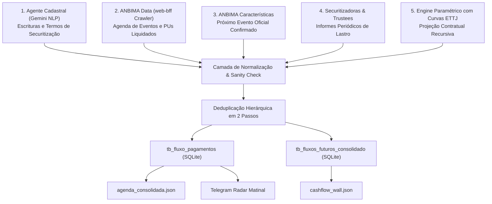

# 📘 Manual Institucional: Fluxo de Pagamentos, Agenda e Calculadora de Duration (DU/252)

> **Documento Mestre Unificado de Engenharia Financeira, Modelagem de Curvas e Arquitetura de Dados**  
> **Sistemas Abrangidos:** FixData / Meu Crédito Privado (`meucreditoprivado.netlify.app`), Apache Airflow 3.x, SQLite `credito_privado.db` e Frontend React/Vite.  
> **Público-Alvo:** Desenvolvedores, Engenheiros de Dados, Analistas Quantitativos e Agentes Autônomos de IA (Antigravity).

---

## 📑 Sumário Executivo

Este manual consolida a especificação técnica, a fundamentação matemática e o runbook operacional de dois pilares centrais da plataforma FixData:
1. **Fluxo & Agenda Multitemporal de Pagamentos:** Ingestão multi-fonte, normalização taxonômica, conciliação de Data Base vs. Liquidação Útil, deduplicação temporal hierárquica e garantia de cobertura para 100% dos ativos vivos.
2. **Calculadora de Duration & Fluxos Futuros com Projeções de Curvas:** Metodologia matemática de apuração de Duration de Macaulay e Modified Duration na convenção brasileira **Dias Úteis / 252 (`DU/252`)**, modelagem da **Estrutura a Termo das Taxas de Juros (ETTJ)** via modelo paramétrico de **Nelson-Siegel-Svensson**, projeção de taxas a termo (*Forward Rates*) para ativos pós-fixados, projeção de inflação implícita (*Breakeven Inflation*) para ativos IPCA+ e desconto a Valor Presente ($PV$) vértice a vértice.

---

# PARTE 1: Fluxo de Pagamentos e Agenda Multitemporal

## 1.1 Topologia de Ingestão Multi-Fonte

A integridade da agenda de pagamentos exige a captura de fontes primárias e secundárias, pois nenhum provedor público individual cobre com exatidão a totalidade do universo de crédito privado brasileiro (Debêntures, CRIs e CRAs). O pipeline combina cinco camadas complementares:



### Detalhamento das 5 Fontes:

1. **Agente Cadastral (`tb_agente_fluxo_pagamentos`):**
   - **Origem:** Extração primária via visão computacional e NLP (Gemini) sobre as Escrituras Públicas de Emissão de Debêntures e Termos de Securitização de CRIs/CRAs depositados na CVM e B3.
   - **Papel:** Fonte canônica para cronogramas de amortizações parciais programadas e regras originais de repactuação.
2. **ANBIMA Data Crawler (`crawl_anbima_agenda_direct`):**
   - **Origem:** Interceptação direta dos endpoints JSON da API `web-bff` do portal ANBIMA Data (`https://data.anbima.com.br/{debentures|certificado-de-recebiveis}/{ticker}/agenda-de-eventos`) via Playwright headless com bloqueio de mídia/fontes pesadas.
   - **Papel:** Fonte de máxima autoridade para eventos já liquidados ou provisionados, com valor unitário (PU) oficial pago e datas exatas de liquidação no Sistema de Pagamentos Brasileiro (SPB).
3. **ANBIMA Características Oficiais (`carrega_eventos_anbima_proximo_evento`):**
   - **Origem:** Tabelas `anbima_debentures_caracteristicas` e `anbima_cricra_caracteristicas`.
   - **Papel:** Captura imediata do próximo evento (`data_proximo_evento >= date('now')`) homologado pela ANBIMA para todos os papéis sob monitoramento diário.
4. **Securitizadoras & Trustees (`cp_securitizadoras`):**
   - **Origem:** Raspagem estruturada de informes mensais e atas de securitizadoras (Opea, Virgo, Cibrasec, True, RB Capital, etc.).
   - **Papel:** Identificação de amortizações extraordinárias de CRIs/CRAs decorrentes de liquidação de lastros imobiliários ou agrícolas.
5. **Engine Paramétrico com Curvas ETTJ (`processa_fluxos_futuros_ativos`):**
   - **Origem:** Algoritmo recursivo que processa todos os ativos vivos de `tb_cadastro_ativos` integrando os vértices da ETTJ da ANBIMA.
   - **Papel:** Garantir que 100% dos ativos vivos possuam datas de cupons, vencimento final e volumes financeiros futuros projetados com a taxa a termo exata de cada período.

---

## 1.2 O Problema Crítico: Data Base Contratual vs. Data de Liquidação Útil

### Diagnóstico do Caso Real (Exemplo `VALED1`):
Ao consultar o papel `VALED1` (ou debêntures corporativas correlatas), observava-se anteriormente que a plataforma apresentava pagamentos registrados no dia 15 e no dia 16 do mesmo mês.
- **Causa Raiz:** A escritura de emissão prevê o pagamento no **dia 15** de cada período (Data Base Contratual). Contudo, nos anos em que o dia 15 incide em sábado, domingo ou feriado bancário nacional (conforme Lei nº 7.089/1983 e Resoluções CMN), o pagamento é automaticamente postergado para o **1º dia útil subsequente** (Data de Liquidação Financeira, ex: dia 16 ou 17).
- Algumas fontes públicas (como sistemas cadastrais) publicavam a data base teórica (`2026-04-15`), enquanto a ANBIMA publicava a data de liquidação efetiva (`2026-04-16`). Sem conciliação, o pipeline gerava **dois registros distintos**, duplicando indevidamente o volume financeiro e gerando alarmes falsos de inadimplência ou duplo pagamento.

### Solução Arquitetural Implementada:
1. **Campos Distintos na Estrutura de Dados:**
   - `data_evento`: Representa a data base de referência da obrigação.
   - `data_liquidacao`: Representa o dia útil em que os recursos são efetivamente creditados na conta de custódia do investidor via Selic/B3.
2. **Deduplicação Hierárquica em Dois Estágios:**
   - **Estágio 1 (Deduplicação Exata):** Elimina registros com a mesma chave composta `(ticker, data_evento, tipo_evento)`.
   - **Estágio 2 (Janela Temporal de Proximidade $\le 7$ dias):** Para o mesmo ativo e mesmo tipo de evento, se dois registros existirem em uma janela de até 7 dias corridos, o pipeline preserva o evento da fonte de maior prioridade hierárquica e unifica a data base e a liquidação em um único evento:
     $$\text{Hierarquia: } \text{ANBIMA Oficial (Prio 1)} > \text{Escritura (Prio 2)} > \text{Securitizadora (Prio 3)} > \text{Paramétrico (Prio 4)}$$

---

## 1.3 Taxonomia e Normalização de Eventos

Strings heterogêneas provenientes dos diversos agentes do mercado são convertidas em 5 tipos canônicos padronizados:

| Tipo Canônico | Termos Originais Mapeados | Descrição Contábil / Financeira |
| :--- | :--- | :--- |
| **`Pagamento de Juros`** | `JUROS`, `REMUNERAÇÃO`, `CUPOM`, `RENDIMENTO`, `PARCELA DE JUROS` | Crédito de rendimentos periódicos incidentes sobre o saldo devedor. |
| **`Amortização`** | `AMORTIZAÇÃO PARCIAL`, `AMORTIZAÇÃO`, `AMORT`, `DEVOLUÇÃO DE CAPITAL` | Devolução parcial do valor nominal do principal. |
| **`Vencimento`** | `RESGATE`, `VENCIMENTO FINAL`, `RESGATE ANTECIPADO`, `AMORTIZAÇÃO 100%` | Liquidação integral do saldo remanescente do papel. |
| **`Repactuação`** | `REPACTUAÇÃO`, `REPACTUA`, `TAXA REPACTUADA` | Data formal de repactuação de condições de remuneração. |
| **`Prêmio`** | `PRÊMIO`, `BONIFICAÇÃO`, `PREMIO DE RESGATE` | Remuneração acessória contratual. |

---

# PARTE 2: Projeção de Curvas no Tempo, ETTJ e Taxas a Termo

## 2.1 Modelagem Teórica: Nelson-Siegel-Svensson (NSS)

A ANBIMA e o Banco Central do Brasil estimam a **Estrutura a Termo das Taxas de Juros (ETTJ)** através da parametrização estendida de Nelson-Siegel proposta por **Lars E. O. Svensson (1994)**. O modelo ajusta uma curva suave e contínua sobre os contratos futuros de DI negociados na B3 e sobre os títulos da dívida pública federal (NTN-B e LTN).

A taxa spot instantânea/anualizada $y(\tau)$ para um prazo $\tau = \frac{DU}{252}$ é expressa formalmente por:

$$y(\tau) = \beta_0 + \beta_1 \left( \frac{1 - e^{-\frac{\tau}{\lambda_1}}}{\frac{\tau}{\lambda_1}} \right) + \beta_2 \left( \frac{1 - e^{-\frac{\tau}{\lambda_1}}}{\frac{\tau}{\lambda_1}} - e^{-\frac{\tau}{\lambda_1}} \right) + \beta_3 \left( \frac{1 - e^{-\frac{\tau}{\lambda_2}}}{\frac{\tau}{\lambda_2}} - e^{-\frac{\tau}{\lambda_2}} \right)$$

### Interpretação Econômica dos Parâmetros:
* $\beta_0$: **Nível de Longo Prazo (*Level*):** Assíntota para a qual convergem as taxas de juros de prazos ultra-longos ($\tau \rightarrow \infty$).
* $\beta_1$: **Inclinação da Curva (*Slope*):** Diferencial entre as taxas de curto e longo prazo. Quando $\tau \rightarrow 0$, a taxa converge para $\beta_0 + \beta_1$ (taxa instantânea de curtíssimo prazo).
* $\beta_2$: **Primeira Curvatura (*Curvature / Hump 1*):** Determina o ponto de corcova em vértices intermediários, com velocidade de decaimento controlada por $\lambda_1$.
* $\beta_3$: **Segunda Curvatura (*Hump 2*):** Inovação de Svensson que adiciona flexibilidade para capturar inflexões complexas em vértices longos, com velocidade controlada por $\lambda_2$.
* $\lambda_1, \lambda_2$: Parâmetros de escala temporal que determinam a localização exata dos picos das curvaturas ao longo da curva.

Os parâmetros diários oficiais da ETTJ são persistidos na tabela `anbima_curva_di`, contendo os coeficientes e as taxas calculadas para 65 vértices diários (de 21 a 8.316 dias úteis).

---

## 2.2 Projeção de Taxas a Termo (*Forward Rates*) para Ativos Pós-Fixados

Para títulos pós-fixados indexados ao CDI (ex: Debêntures **CDI + 2,00%** ou **105% do CDI**), a remuneração de um cupom futuro entre os vértices $T_1$ e $T_2$ depende da taxa média de juros que o mercado projeta para aquele intervalo temporal.

Pelo princípio da não-arbitragem, a **Taxa a Termo Anualizada (*Forward Rate*)** entre o vértice de início $T_1 = \frac{DU_1}{252}$ e o vértice de liquidação $T_2 = \frac{DU_2}{252}$ é dada por:

$$F(T_1, T_2) = \left[ \frac{(1 + r_2)^{T_2}}{(1 + r_1)^{T_1}} \right]^{\frac{1}{T_2 - T_1}} - 1$$

Onde:
* $r_1$: Taxa spot anual da Curva DI para o prazo $T_1$.
* $r_2$: Taxa spot anual da Curva DI para o prazo $T_2$.

### Cálculo do Cupom Futuro Projetado:
Com a taxa a termo $F(T_1, T_2)$ calculada, a taxa periódica do cupom é projetada de forma exata:
1. **Para ativos DI + Spread (ex: CDI + 2,00% a.a.):**
   $$r_{\text{anual composto}} = (1 + F_{\text{DI}}) \times (1 + \text{Spread}) - 1$$
   $$\text{Taxa Cupom}_{\text{período}} = (1 + r_{\text{anual composto}})^{\frac{DU_2 - DU_1}{252}} - 1$$
   $$\text{Volume Cupom} = \text{Saldo Devedor} \times \text{Taxa Cupom}_{\text{período}}$$
2. **Para ativos % do CDI (ex: 105% do CDI):**
   $$r_{\text{anual}} = \left(\frac{\alpha}{100}\right) \times F_{\text{DI}}$$
   $$\text{Taxa Cupom}_{\text{período}} = (1 + r_{\text{anual}})^{\frac{DU_2 - DU_1}{252}} - 1$$

> **Impacto Prático:**  
> Anteriormente, pipelines simplistas aplicavam apenas o *spread* (ex: 2,00% a.a. $\rightarrow \approx 0{,}99\%$ ao semestre), gerando fluxos subestimados. Com a engine de curvas a termo, uma debênture CDI + 2,00% sob DI projetado de $12{,}89\%$ a.a. projeta um cupom semestral real de **$7{,}31\%$** (refletindo fielmente a expectativa de liquidez futura).

---

## 2.3 Projeção de Inflação Implícita (*Breakeven Inflation*) e Atualização do $VNa$

Para ativos indexados ao IPCA (Debêntures Incentivadas Lei 12.431, CRIs e CRAs), o fluxo financeiro futuro em moeda corrente nominal depende da evolução do **Valor Nominal Atualizado ($VNa$)**.

Pelo Teorema de Fisher, a taxa de juros prefixada nominal se decompõe no produto da taxa de juros real pela inflação esperada:
$$(1 + y_{\text{nominal}}(\tau)) = (1 + y_{\text{real}}(\tau)) \times (1 + \pi_{\text{impl}}(\tau))$$

Isolando a **Inflação Implícita Anualizada ($\pi_{\text{impl}}$)** para o vértice $\tau = \frac{DU}{252}$:
$$\pi_{\text{impl}}(\tau) = \frac{1 + y_{\text{ETTJ\_PREF}}(\tau)}{1 + y_{\text{ETTJ\_IPCA}}(\tau)} - 1$$

### Projeção do Fator de Atualização do $VNa$:
O fator acumulado projetado de inflação entre a data base de hoje e o vértice futuro $DU$ é dado por:
$$\text{Fator Inflação Acumulado}(DU) = (1 + \pi_{\text{impl}}(DU))^{\frac{DU}{252}}$$

No cálculo da grade consolidada de fluxos nominais futuros:
$$VNa(DU) = VNa_0 \times \text{Fator Inflação Acumulado}(DU)$$
$$\text{Cupom Nominal}(DU) = VNa(DU) \times \left[(1 + y_{\text{real}})^{\frac{126}{252}} - 1\right]$$
$$\text{Resgate Final no Vencimento} = \text{Saldo Devedor Principal} \times \text{Fator Inflação Acumulado}(DU_{\text{venc}})$$

---

# PARTE 3: Calculadora de Duration e Desconto a Valor Presente

## 3.1 Convenção de Calendário Brasileira (Dias Úteis / 252)

O mercado financeiro de renda fixa e crédito privado brasileiro opera sob a convenção estrita de **Dias Úteis sobre base anual de 252 dias úteis (`DU/252`)**, conforme padronização da ANBIMA e B3.

### Algoritmo Astronômico de Meeus/Jones/Butcher para Feriados Móveis:
O módulo `cp_anbima/calculadora_duration.py` calcula analiticamente (2015 a 2060) as datas dos feriados móveis dependentes da Páscoa:
- **Segunda-feira de Carnaval:** Páscoa $- 48$ dias corridos.
- **Terça-feira de Carnaval:** Páscoa $- 47$ dias corridos.
- **Sexta-feira da Paixão:** Páscoa $- 2$ dias corridos.
- **Corpus Christi:** Páscoa $+ 60$ dias corridos.

A conversão do prazo em dias úteis ($DU$) para o prazo fracionário em anos úteis ($t_{\text{anos}}$) é dada por:
$$t_{\text{anos}} = \frac{DU}{252}$$

---

## 3.2 Fórmulas Matemáticas de Duration com Curva a Termo

### 1. Desconto Vértice a Vértice na Curva ETTJ
Em finanças quantitativas modernas, fluxos futuros em prazos distintos **não devem ser descontados por uma taxa fixa arbitrária flat**. Cada fluxo $CF_j$ no vértice $DU_j$ possui seu próprio fator de desconto $d(DU_j)$ determinado pela ETTJ:

$$d(DU_j) = \frac{1}{(1 + y(DU_j))^{\frac{DU_j}{252}}}$$

Onde $y(DU_j)$ é a taxa zero da curva soberana para o prazo $DU_j$ somada ao spread de crédito do emissor:
* Para ativos IPCA+: $y(DU_j) = y_{\text{ETTJ\_IPCA}}(DU_j) + \text{Spread}$
* Para ativos Pré-Fixados: $y(DU_j) = y_{\text{ETTJ\_PREF}}(DU_j) + \text{Spread}$

O Preço Unitário Teórico a Valor Presente ($PU$) é a soma dos fluxos descontados:
$$PU = \sum_{j=1}^K CF_j \cdot d(DU_j)$$

### 2. Duration de Macaulay com Estrutura a Termo (*Term-Structure Macaulay Duration*)
A Duration de Macaulay pondera cada fluxo pelo seu valor presente exato obtido da curva:

$$D_{\text{Mac}} = \frac{\sum_{j=1}^K \left(\frac{DU_j}{252}\right) \cdot \left[ CF_j \cdot d(DU_j) \right]}{\sum_{j=1}^K \left[ CF_j \cdot d(DU_j) \right]} = \frac{\sum_{j=1}^K \left(\frac{DU_j}{252}\right) \cdot PV(CF_j)}{PU}$$

### 3. Duration Modificada ($D_{\text{mod}}$) e Sensibilidade ($\Delta PU$)
A Duration Modificada com curva a termo reflete a elasticidade média frente a um choque paralelo em toda a ETTJ:

$$D_{\text{mod}} = \frac{\sum_{j=1}^K \left(\frac{DU_j}{252}\right) \cdot \left( \frac{1}{1 + y(DU_j)} \right) \cdot PV(CF_j)}{PU}$$

Para um choque marginal de $\Delta y_{\text{bps}}$ pontos-base:
$$\frac{\Delta PU}{PU} \approx - D_{\text{mod}} \cdot \left(\frac{\Delta y_{\text{bps}}}{10.000}\right)$$

---

## 3.3 Tratamento por Classe de Indexador

### 1. Títulos Indexados à Inflação (IPCA+ / NTN-B Like)
- Cupons semestrais calculados na base exponencial: $c_{\text{sem}} = (1 + y_{\text{cupom}})^{\frac{126}{252}} - 1$.
- Incidência rigorosa sobre o saldo devedor remanescente a cada período de amortização.
- Desconto a valor presente utilizando a curva real $y_{\text{ETTJ\_IPCA}}(DU_j) + \text{Spread}$.

### 2. Títulos Pós-Fixados (DI+ e DI% / CDI)
- O risco de taxa Selic repactua diariamente ($\text{duration de juros} \approx 1 \text{ DU}$).
- A métrica institucional calculada e exibida é a **Spread Duration** (sensibilidade ao prêmio de crédito sobre o CDI).
- Para títulos *bullet*, equivale ao prazo total remanescente em anos úteis ($DU / 252$).
- Para títulos com amortizações periódicas conhecidas, equivale rigorosamente ao **Prazo Médio Ponderado (PMP)** do retorno do principal:
  $$\text{Spread Duration} = \frac{\sum_{i=1}^M \left(\frac{DU_i}{252}\right) \cdot \text{Amortização}_i}{\sum_{i=1}^M \text{Amortização}_i}$$

### 3. Títulos Pré-Fixados
- Desconto exponencial direto dos fluxos nominais prefixados pela curva $y_{\text{ETTJ\_PREF}}(DU_j)$.

---

# PARTE 4: Guia de Operação e Manutenção para IAs e Desenvolvedores

## 4.1 Mapa de Módulos e Responsabilidades

| Caminho do Arquivo | Módulo / Classe | Responsabilidade Técnica |
| :--- | :--- | :--- |
| `src/cp_anbima/curva_di.py` | `ETTJCurvasEngine` | Engine institucional de interpolação spot e forward para Curvas DI, IPCA e Inflação Implícita (NSS). |
| `src/cp_anbima/calculadora_duration.py` | `calcular_duration_ativo` / `calcular_duration_fluxo_exato` | Motor matemático institucional de contagem de feriados móveis, dias úteis, duration `DU/252` e desconto na ETTJ. |
| `src/cp_fluxo_pagamentos/main.py` | `captura_e_consolida_fluxos` | Pipeline de ingestão multi-fonte, normalização taxonômica e deduplicação temporal em 2 passos. |
| `src/cp_fluxos_futuros/main.py` | `processa_fluxos_futuros_ativos` | Projeção em escala de 100% dos fluxos futuros vivos com taxas a termo da ETTJ e geração de `cashflow_wall.json`. |
| `src/cp_site/atualiza_assets_master.py`| `atualiza_assets_master` | Enriquecimento cadastral de duration calculada no dataset central de ativos. |
| `src/cp_telegram/morning_report.py` | `montar_mensagem_matinal` | Monitor diário de eventos do dia, volume financeiro e maiores pagadores. |
| `fixdata/` (Frontend) | `src/utils/calculatorMath.ts` | Motor matemático client-side em TypeScript para simulação de cenários, MTM e gross-up. |

---

## 4.2 Comandos Rápidos de Validação e Execução

```bash
# 1. Testar o motor matemático de Duration com desconto na ETTJ:
python3 -m cp_anbima.calculadora_duration

# 2. Executar a consolidação da Agenda de Pagamentos:
python3 -m cp_fluxo_pagamentos.main

# 3. Processar a projeção dos 111.000+ fluxos futuros com curvas a termo e gerar o cashflow_wall.json:
python3 -m cp_fluxos_futuros.main

# 4. Simular o relatório matinal de pagamentos do Telegram:
python3 -m cp_telegram.morning_report
```

---

## 4.3 Matriz de Resolução de Problemas (Troubleshooting)

| Sintoma Observado | Causa Mais Provável | Ação Corretiva Imediata |
| :--- | :--- | :--- |
| **Ativo aparece pagando em duas datas consecutivas (ex: dias 15 e 16)** | Colisão entre Data Base contratual e Data Útil de liquidação provenientes de fontes distintas. | O passo 2 de `sanity_check_e_deduplicacao` (janela $\le 7$ dias) unifica automaticamente. Verificar se a flag de prioridade de fonte está configurada corretamente no módulo `cp_fluxo_pagamentos/main.py`. |
| **Duration retornando `None` ou `0.0` para um ativo** | Data de vencimento nula, malformada ou no passado; ativo vencido ainda classificado como vivo. | Inspecionar a data em `tb_cadastro_ativos`. A função `count_business_days` rejeita datas anteriores a `data_base`. Executar `python3 -m cp_cadastro_ativos.main`. |
| **Erro `OperationalError: no such table: ..._old` no Airflow** | Swap inseguro de tabelas SQLite com `ALTER TABLE ... RENAME TO` enquanto leitores concorrentes consultavam a view. | Manter a regra cardeal: **Nunca renomear tabelas de produção diretamente**. Utilizar sempre o padrão de Staging seguro (`DELETE FROM target; INSERT INTO target SELECT * FROM staging; DROP TABLE staging;`). |
| **Volume financeiro do ativo inflado (> R$ 15 Bilhões)** | Título de CRI/CRA com quantidade de cotas multiplicada indevidamente por PU R$ 1.000 em vez de PU nominal R$ 1,00. | O módulo `cp_fluxos_futuros/main.py` possui trava de sanidade automática que identifica securitizações com PU unitário de R$ 1,00 e teto de R$ 15 Bi por emissão privada. |
